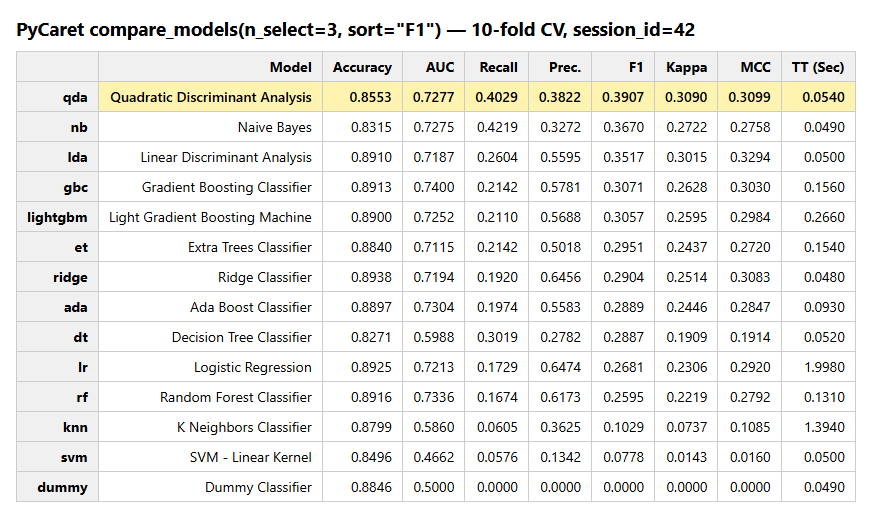
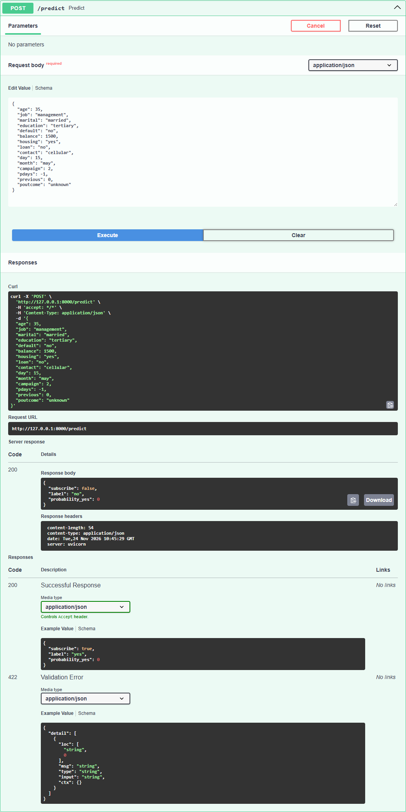

# Term-Deposit Subscription Predictor: PyCaret vs. scikit-learn, served with FastAPI

This project compares a low-code machine learning workflow (PyCaret) with a hand-built one (scikit-learn) on the same business problem. It then serves the scikit-learn model as a web API with FastAPI.

## Business problem and dataset

**Problem.** A Portuguese bank sells term deposits by phone. Only about 11.5% of the clients it calls say yes, so most agent time goes to calls that fail. **Before an agent dials, the model predicts whether a client will subscribe (`yes`/`no`).** The bank can then put likely subscribers at the top of the call list.

**Dataset.** [UCI Machine Learning Repository: Bank Marketing](https://archive.ics.uci.edu/dataset/222/bank+marketing) (Moro, Cortez & Rita, 2014). I used `bank.csv`, the official 10% sample of `bank-full.csv`. I saved it as comma-separated values in [`data/bank.csv`](data/bank.csv).

| Requirement | This dataset |
|---|---|
| ≥ 1,000 rows | 4,521 rows |
| Categorical target | `y`: `no` (4,000) / `yes` (521), two classes |
| ≥ 4 features, at least one categorical | 15 features used: 6 numeric (`age`, `balance`, `day`, `campaign`, `pdays`, `previous`) and 9 categorical (`job`, `marital`, `education`, `default`, `housing`, `loan`, `contact`, `month`, `poutcome`) |

**Dropped columns.**

* `duration` is the length of the call in seconds. The bank only knows it **after the call ends**, and a 0-second call is always a "no". Keeping it would leak the answer into the model, and the model could never use it at prediction time, because the prediction happens before dialing. The UCI documentation itself says to discard it for a realistic model.
* There are **no ID columns** in this dataset, so no other columns needed dropping.

The data has no missing values, but some categorical columns contain `unknown`. I treat `unknown` as its own category. The scikit-learn pipeline still imputes, in case a future request arrives with a missing value.

## Project layout

```
discovery.py        # Part 2: PyCaret workflow, then scikit-learn workflow (runs top to bottom)
main.py             # Part 3: FastAPI app serving model.joblib
model.joblib        # fitted scikit-learn Pipeline (preprocessing + model)
data/bank.csv       # dataset
images/             # screenshots: comparison table, confusion matrix, /docs predictions
pyproject.toml, uv.lock
```

## How to run

Requires [uv](https://docs.astral.sh/uv/). uv installs Python 3.11 automatically, because PyCaret only supports Python 3.9–3.11.

```bash
git clone https://github.com/moneybanker004/ml-pipeline.git
cd ml-pipeline
uv run discovery.py           # both workflows; writes model.joblib and images/ (about 1-2 min)
uv run fastapi dev main.py    # start the API, then open http://127.0.0.1:8000/docs
```

The first `uv run` installs about 150 packages, so it takes a few minutes.

`model.joblib` is already committed, so `main.py` also works without running `discovery.py` first. To test the API, open `/docs`, expand **POST /predict**, click **Try it out**, then **Execute**. The example request is pre-filled. You can also send it from a terminal:

```bash
curl -X POST http://127.0.0.1:8000/predict -H "Content-Type: application/json" -d '{"age":35,"job":"management","marital":"married","education":"tertiary","default":"no","balance":1500,"housing":"yes","loan":"no","contact":"cellular","day":15,"month":"may","campaign":2,"pdays":-1,"previous":0,"poutcome":"unknown"}'
```

*macOS:* LightGBM needs the OpenMP runtime. If importing PyCaret fails with a `libomp` error, run `brew install libomp` first.

---

## Part 2: Comparing the workflows

### PyCaret workflow

`setup(data=df, target="y", session_id=42)` is followed by `compare_models(n_select=3, sort="F1")`. I sorted by F1 rather than the default Accuracy: with 88.5% "no" answers, a model that always says "no" already scores 88.5% accuracy (see the Dummy row).



PyCaret ranked **Quadratic Discriminant Analysis (QDA)** best on F1, followed by Naive Bayes and LDA. LightGBM finished 5th. Saved confusion matrix for QDA (PyCaret's 30% hold-out set):


**PyCaret section run time: 64.1 s** (measured with `time.perf_counter()` in `discovery.py` on a warm run; 124–155 s on a cold first run from a fresh clone).

### scikit-learn workflow

* `train_test_split(test_size=0.3, stratify=y, random_state=42)`
* `ColumnTransformer`:
  * numeric columns: median `SimpleImputer` → `StandardScaler`
  * categorical columns: most-frequent `SimpleImputer` → `OneHotEncoder(handle_unknown="ignore")`
* `Pipeline([preprocess, QuadraticDiscriminantAnalysis()])`, saved with `joblib.dump(model, "model.joblib")`

The script reads the name of PyCaret's best model and builds the same estimator. The model is a standard scikit-learn class, so it fits inside a `Pipeline`.

Classification report on the held-out test set (1,357 clients):

```
              precision    recall  f1-score   support

          no      0.920     0.707     0.799      1201
         yes      0.189     0.526     0.278       156

    accuracy                          0.686      1357
   macro avg      0.554     0.616     0.539      1357
weighted avg      0.836     0.686     0.739      1357

Confusion matrix [rows = actual no/yes, cols = predicted no/yes]
[[849 352]
 [ 74  82]]
```

### Comparison (answers to step 5)

**Which workflow was more efficient?** PyCaret, clearly. Its section is **14 lines** and compared 14 models in **64 s**. The scikit-learn section is **about 85 lines** and fits in 0.1 s, but it builds only one model, the one PyCaret had already picked. Writing and debugging the `ColumnTransformer` took far longer than either run.

**Why don't the scores match?** PyCaret reports the **average of 10-fold cross-validation** on the training data: F1 0.391 (precision 0.382, recall 0.403). My scikit-learn scores come from **one held-out test set**: F1 0.278 for "yes" (precision 0.189, recall 0.526). Even PyCaret's own QDA scores lower on its hold-out set (F1 0.331, from the confusion matrix above). Preprocessing also differs. PyCaret encodes binary columns as 0/1 without scaling, while I one-hot encode everything and scale. QDA is sensitive to collinear one-hot columns.

**Which metric matters most?** **F1 on the "yes" class.** Predicting "no" for everyone scores 88.5% accuracy and finds no customers. Calling everyone gives 100% recall and wastes the call budget. Missed subscribers lose revenue and wasted calls cost agent time, so F1 balances precision and recall.

---

## Part 3: Serving the model

`main.py` loads `model.joblib` **once at startup** (FastAPI `lifespan`), not inside the endpoint. The Pydantic class `Client` has one field per feature. The categorical fields use `Literal[...]` types, so `/docs` shows the allowed values, and the numeric fields have range checks (for example, `age >= 18`). `POST /predict` turns the JSON into a one-row DataFrame, runs `model.predict()` and returns JSON.

```bash
uv run fastapi dev main.py
```

**Sample input** (`POST /predict`):

```json
{
  "age": 35, "job": "management", "marital": "married", "education": "tertiary",
  "default": "no", "balance": 1500, "housing": "yes", "loan": "no",
  "contact": "cellular", "day": 15, "month": "may", "campaign": 2,
  "pdays": -1, "previous": 0, "poutcome": "unknown"
}
```

**Output:**

```json
{"subscribe": false, "label": "no", "probability_yes": 0.0}
```

Successful prediction from "Try it out" in `/docs`:



### Explaining a prediction (step 8)

I changed **one input**, `month`, from `"may"` to `"oct"`, and left everything else the same.

| Input | `month` | Prediction | `probability_yes` |
|---|---|---|---|
| Original | `may` | **no** | 0.0 |
| Changed | `oct` | **yes** | 1.0 |


**Does this make sense for the business?** Partly. The data supports it: only **6.7%** of clients called in May subscribed, against **46.2%** in October (March, September and December are also above 30%). May was the bank's mass-calling month, with the most calls and the lowest hit rate. The few autumn and winter calls were fewer and more targeted. So the model is right that a call in October is more likely to succeed than one in May. But month is mostly a stand-in for *how the campaign was run*, not something about the client, and the bank cannot make this client subscribe just by calling in October. The jump from exactly 0 to exactly 1 also comes from QDA's overconfidence (see above). A real client's probability would not swing that far on the month alone. For this reason I would trust the **ranking** of clients more than the raw probabilities.

For comparison, I also tested changing only `poutcome` to `"success"` (previous campaign succeeded). That also flips the prediction to "yes", which makes clear business sense: 64% of those clients subscribed in the data. I did not use it as the main example, because a real client with `poutcome = "success"` would also have `previous > 0` and `pdays >= 0`, so changing that one field alone creates an unrealistic record.

---

## AI use

I used **Claude Code** (an AI coding assistant) to write most of the code in `discovery.py` and `main.py`, and to draft this README. I let it write the standard boilerplate, meaning the PyCaret `setup`/`compare_models` calls, the `ColumnTransformer`, and the FastAPI endpoint. I made the decisions: the dataset, dropping `duration`, using F1 as the metric, and the prediction experiment.

**What I fixed:** in the first run, PyCaret's Recall column was identical to Accuracy. That is impossible for the rare "yes" class. Because the target was passed as the strings `yes`/`no`, PyCaret was reporting *weighted* averages over both classes (F1 around 0.87). Encoding the target as 1/0 gave the real F1 for "yes", about 0.39, and changed the best model. I also noticed that LightGBM was missing from the comparison table. LightGBM 4.7 crashes inside PyCaret on Windows, so I pinned it to 4.5.

**How I checked:** I compared the metric columns against each other, confirmed that the test-set counts match a 30% stratified split (1,201 + 156), sent valid and invalid requests to `/predict`, and checked the prediction explanation against subscription rates in the raw data.
